# Evolución de las matriculaciones y etiquetas medioambientales de la DGT (2021–2025)

**Proyecto Capstone de análisis de datos** · Python · Pandas · Machine Learning · Power BI

## Autores

Este proyecto Capstone ha sido **creado y desarrollado íntegramente de forma conjunta por Gabriel Loimil y Javier Loimil**, en el marco de la formación en Análisis de Datos de Immune Technology Institute. Ambos son **coautores del proyecto completo**, con igual reconocimiento por todas sus fases: recopilación y preparación de datos, análisis exploratorio, Machine Learning, desarrollo de dashboards en Power BI, interpretación de resultados y presentación.

- **Gabriel Loimil** — [GitHub: gaboloimil](https://github.com/gaboloimil)
- **Javier Loimil** — [GitHub: javierloimil](https://github.com/javierloimil)

**Autoría compartida en igualdad de condiciones.**

## Descripción

Análisis de la evolución de las matriculaciones de **turismos y motocicletas en España** entre 2021 y 2025, desglosadas por provincia y por las cinco categorías medioambientales de la DGT: **Cero, B, C, ECO y Sin distintivo**.

El proyecto integra limpieza y transformación de datos, análisis exploratorio, comparación territorial, agrupamiento de provincias mediante **K-Means**, modelos de **regresión lineal** y visualización en **Power BI**.

## Resultados principales

- Las matriculaciones de **turismos** pasan de **953.624 en 2021** a **1.304.292 en 2025**.
- Las matriculaciones de **motocicletas** pasan de **173.435 en 2021** a **248.514 en 2025**.
- En turismos, la participación de la etiqueta **C** baja del **66,17 % al 36,70 %**, mientras **ECO** aumenta del **23,67 % al 41,64 %** y **Cero** del **6,50 % al 18,12 %**.
- En motocicletas, la etiqueta **C** sigue siendo predominante, con aproximadamente el **96,2 %** en 2025.

## 1. Análisis exploratorio

### Matriculaciones por tipo de vehículo

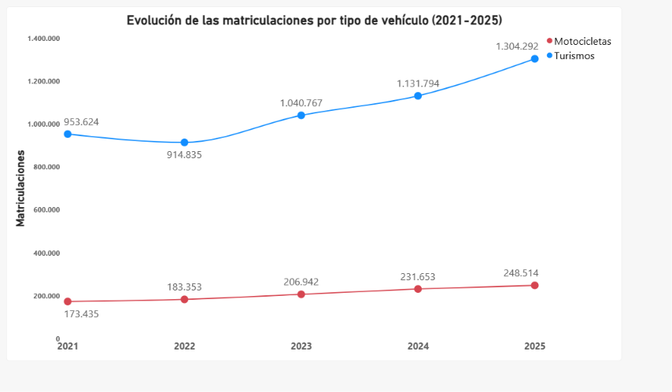

### Evolución de etiquetas en turismos

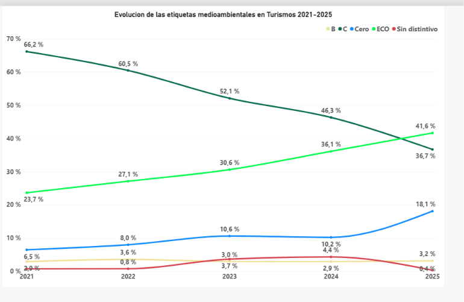

### Evolución de etiquetas en motocicletas

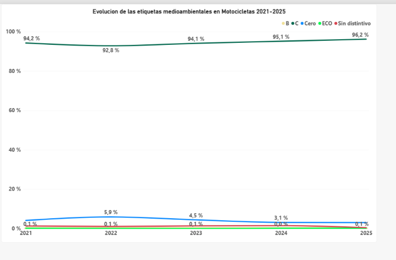

## 2. Segmentación territorial: clustering

Se aplica **K-Means** sobre los cambios en puntos porcentuales de las cinco etiquetas entre 2021 y 2025, con estandarización previa de las variables. Se analizan **52 provincias y territorios** por tipo de vehículo.

### Turismos: cinco clusters

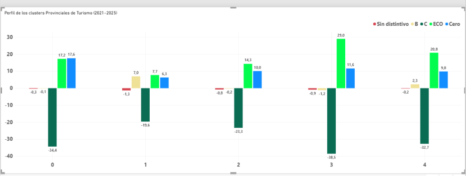

### Motocicletas: tres clusters

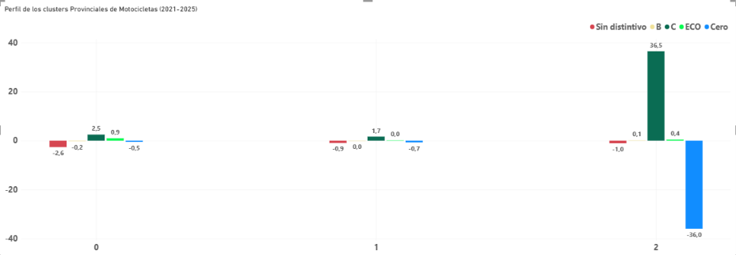

Los números de cluster son identificadores de grupos, no una clasificación de mejores o peores provincias.

## 3. Regresión lineal y proyecciones

Se emplean modelos de regresión lineal para explorar la evolución futura del total de matriculaciones y de cada etiqueta medioambiental. Las proyecciones constituyen **estimaciones exploratorias**, no previsiones garantizadas.

### Proyección del total de turismos (2026–2027)

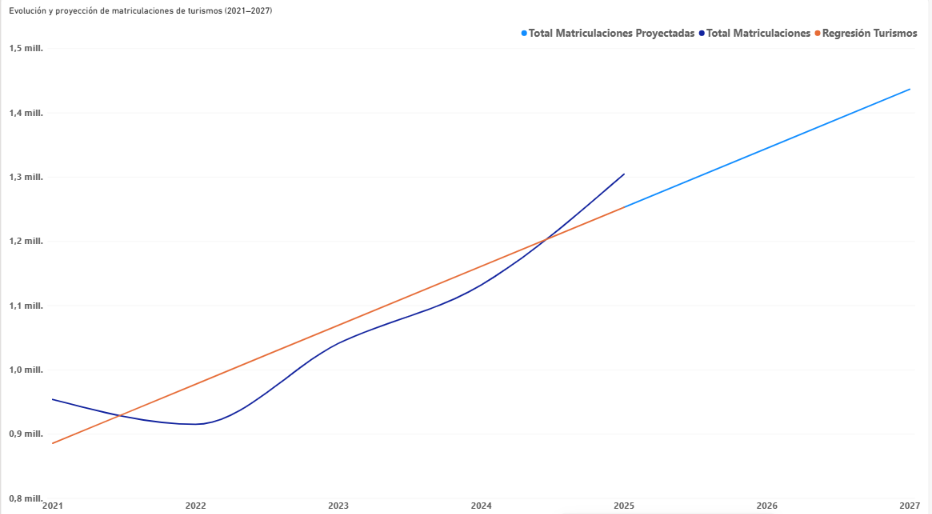

### Proyección del total de motocicletas (2026–2027)

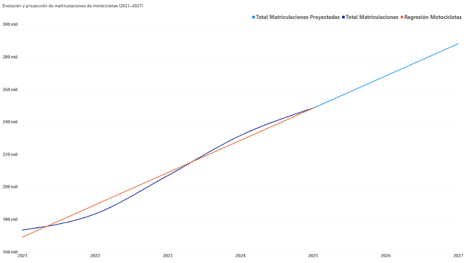

### Turismos: valores reales frente a regresión

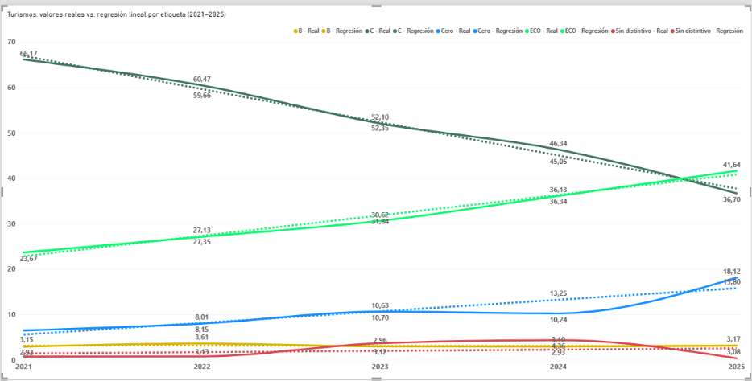

### Turismos: proyección por etiqueta

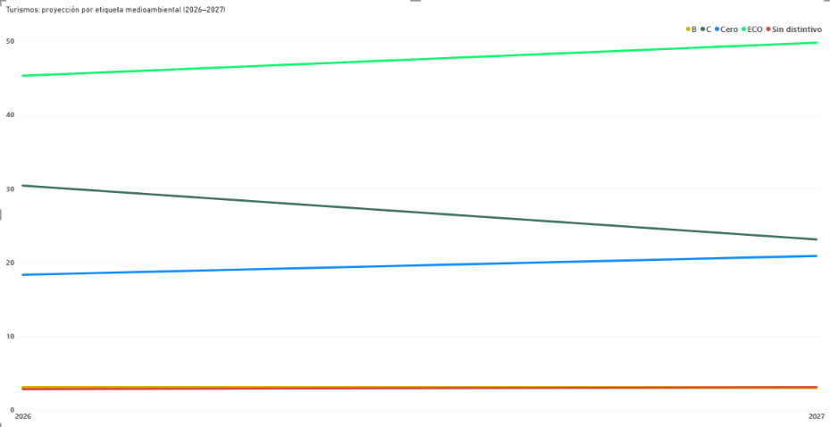

### Motocicletas: valores reales frente a regresión

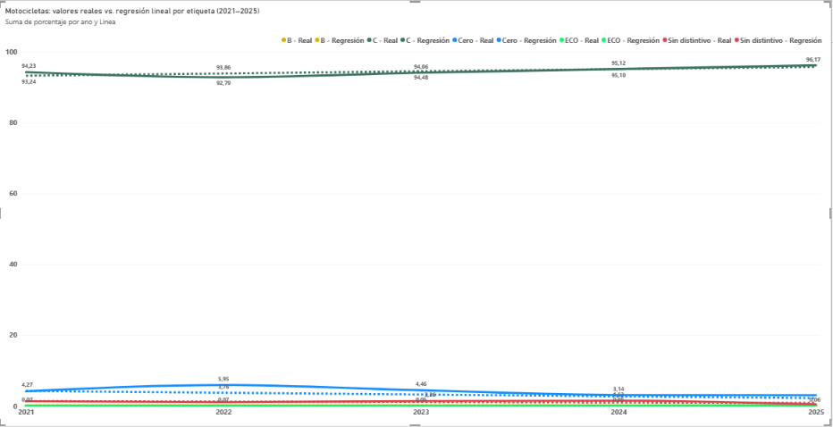

### Motocicletas: proyección por etiqueta

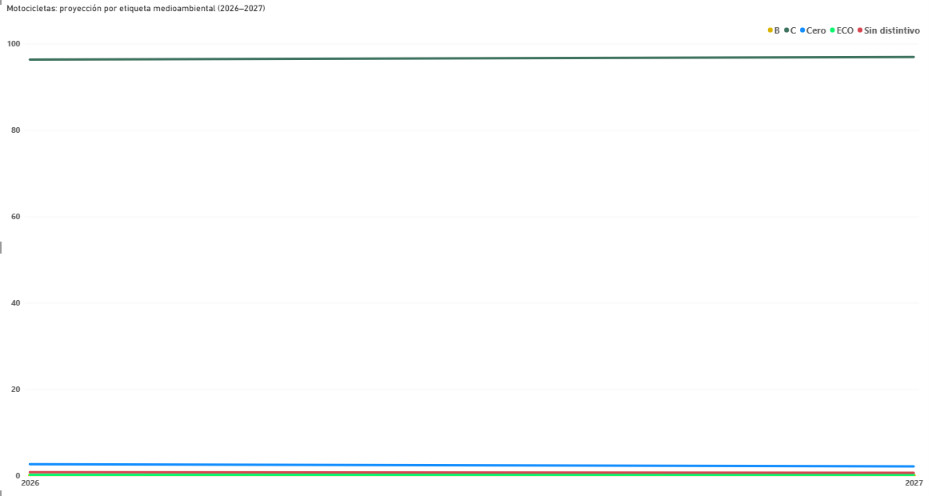

### Evolución del criterio metodológico

Inicialmente se exploró un horizonte de predicción **2026–2030**. Tras revisar la disponibilidad de datos —únicamente cinco observaciones anuales, de 2021 a 2025— se decidió **centrar las conclusiones y visualizaciones finales en 2026–2027**, como horizonte más prudente.

El código conserva **ambas etapas**, para documentar cómo evolucionó el planteamiento analítico. El archivo `proyecciones_powerbi.csv` conserva las proyecciones exploratorias hasta 2030.

**Limitación importante:** las matriculaciones absolutas y los porcentajes por etiqueta se proyectan con modelos independientes. Por ello, los porcentajes proyectados no equivalen necesariamente a dividir las matriculaciones proyectadas de cada etiqueta entre el total proyectado.

## 4. Estructura del repositorio

```text
Capstone_DGT/
├── capstone_dgt_completo.py
├── README.md
├── requirements.txt
├── .gitignore
├── data/                      # Excel originales, descarga externa
│   ├── 2021/
│   ├── 2022/
│   ├── 2023/
│   ├── 2024/
│   └── 2025/
├── outputs/                   # CSV generados al ejecutar el script
└── dashboards/
    ├── proyecto matriculaciones.pbix
    └── capturas/              # 11 imágenes del análisis
```

## 5. Reproducción del análisis

1. Descarga los **cinco Excel originales** de las estadísticas de matriculaciones de la **Dirección General de Tráfico (DGT)**, correspondientes a 2021–2025. Comprueba las condiciones de reutilización de la fuente.
2. Colócalos en `data/2021/`, `data/2022/`, etc., con los nombres esperados por el script:

   - `data/2021/Matriculaciones-Tablas-estadisticas2021.xlsx`
   - `data/2022/Matriculaciones-Tablas-estadisticas-2022.xlsx`
   - `data/2023/Matriculaciones-Tablas-estadisticas-2023.xlsx`
   - `data/2024/Matriculaciones-Tablas-estadisticas-2024.xlsx`
   - `data/2025/Matriculaciones-Tablas-estadisticas-2025.xlsx`

3. Instala las dependencias:

   ```bash
   pip install -r requirements.txt
   ```

4. Ejecuta:

   ```bash
   python capstone_dgt_completo.py
   ```

5. Abre `dashboards/proyecto matriculaciones.pbix` en Power BI Desktop. Si Power BI no encuentra los CSV, actualiza sus rutas de origen hacia la carpeta `outputs/` de tu equipo.

Los CSV exportados emplean **punto y coma (`;`) como delimitador y coma (`,`) como separador decimal**. Para leerlos con pandas:

```python
df = pd.read_csv("outputs/datos_powerbi.csv", sep=";", decimal=",")
```

## 6. Tecnologías

- **Python:** procesamiento, análisis, visualización y modelado.
- **Pandas y NumPy:** preparación y transformación de datos.
- **Matplotlib:** gráficos.
- **Scikit-learn:** K-Means, estandarización y regresión lineal.
- **Power BI:** informes y visualizaciones interactivas.

## 7. Fuente y alcance

**Fuente:** tablas estadísticas anuales de matriculaciones de la **Dirección General de Tráfico (DGT)**, España, 2021–2025.

Este repositorio distribuye el código y las visualizaciones del proyecto. Los archivos Excel de origen deben obtenerse de la fuente oficial; no se incluyen en el paquete. Las tendencias observadas no demuestran por sí solas relaciones causales y las extrapolaciones se basan en una serie temporal corta.

## 8. Autoría del proyecto

Este proyecto Capstone fue desarrollado **conjuntamente y en su totalidad por Gabriel Loimil y Javier Loimil**, durante su formación en Análisis de Datos en Immune Technology Institute. Ambos son **coautores del proyecto con igual reconocimiento** en todas sus fases: recopilación y preparación de datos, análisis exploratorio, Machine Learning, desarrollo de visualizaciones en Power BI, interpretación de resultados y presentación.

- **Gabriel Loimil:** [github.com/gaboloimil](https://github.com/gaboloimil)
- **Javier Loimil:** [github.com/javierloimil](https://github.com/javierloimil)
